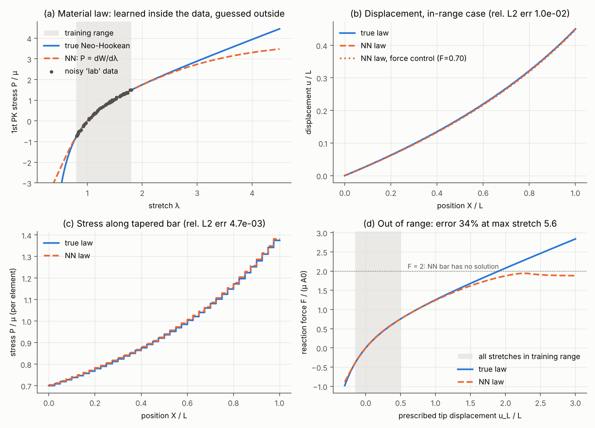

# A neural-network material law inside a tiny nonlinear FE solver

**Question.** If a material law is learned from noisy lab data, can it replace the analytical law inside a
Newton–Raphson FE solver? And what happens when the structure is loaded beyond the stretches the network saw?

## Method
1. **Ground truth.** 1D total-Lagrangian FE for a tapered bar (A goes from 1 to 0.5, 40 linear elements, 1 Gauss point),
   clamped at X=0 and loaded at the tip. Incompressible Neo-Hookean: W = μ/2(λ²+2/λ−3), P = μ(λ−1/λ²).
   Newton–Raphson uses the consistent tangent and load stepping. It converges quadratically (4 iterations per step to 1e-10),
   and AP = F holds to 1e-15 under force control.
2. **Data.** 60 stretch–stress pairs, λ ∈ [0.8, 1.8], with Gaussian noise σ = 0.02μ (≈ 1–3 % of the stress), standing in for one uniaxial test.
3. **Learned material.** A small MLP N(λ) (2×16, softplus) is normalised so the reference state carries no stress or energy:
   **W(λ) = N(λ) − N(1) − N′(1)(λ−1)**. Stress is **P = ∂W/∂λ** and the Newton tangent is **∂²W/∂λ²**, both from autograd.
   Training fits only the stress data (Adam, then L-BFGS).
4. **Plug in.** The same solver and load case run with `material=EnergyNet` instead of `NeoHookean`. The solver code doesn't change.
5. **Compare.** The in-range case (u_L = 0.45, so every element has λ ∈ [1.30, 1.72]) uses displacement and force control.
   A sweep then runs out to λ ≈ 5.6.

## Results (`python run_demo.py`, output in `run_output.txt`)
| | error |
|---|---|
| Stress fit, max \|P_nn − P\| inside the training range | 0.012 μ (below the noise level of 0.02) |
| **In-range FE: displacement, rel. L2 (displacement control / force control)** | **0.46 % / 1.0 %** |
| In-range FE: stress and reaction force, rel. L2 | 0.47 % |
| Newton iterations per load step, NN vs true | 4 vs 4 (the autograd tangent is exact, so convergence stays quadratic) |
| Reaction at max stretch 4.2 / 5.6 (outside the data) | 9.7 % / **34 %** too low |

## What broke (the interesting part)
* **Stiffening is lost.** A softplus MLP becomes linear for large λ. Then W ~ cλ, so the learned stress *saturates*
  (P_nn → 3.7 vs a true value of P = 10 at λ = 10). Under compression, true P → −∞ as λ → 0 (you can't squash a material to zero volume),
  but the NN gives only −4.6 at λ = 0.05. Panel (a) shows both.
* **The energy loses convexity.** The learned P peaks at λ ≈ 9.6 and then falls (∂²W/∂λ² < 0). The FE model shows the consequence:
  past u_L ≈ 2.3 the force drops and **all deformation localises into the thinnest element (λ = 45 while its neighbours unload)**.
  That is spurious necking. It's a material instability invented by the network, and the result now depends on the mesh.
* **Force control fails.** The NN bar can never carry more than A_min·max P_nn = 1.94. At F = 2 there is *no equilibrium solution*,
  so Newton stalls even though the true bar is fine (λ_max = 4). At F = 1.9 the NN predicts λ_max = 6.2 against a true value of 3.8.
* **The failure is systematic.** Over 5 random seeds (`seed_study.py`), every network fits P(1.3) to within 2 %. Every network also underpredicts P(4)
  by 16–23 % and P(0.4) by 44–50 %. The extrapolation follows from the architecture's asymptotics, not from bad luck in training.
* A solver lesson along the way: under displacement control, putting the whole increment into the last element sent that element to
  λ = 3 on the first iteration, outside the data. Newton then overshot to λ < 0. A linear predictor fixed it.
  A learned law makes the solver less forgiving of bad trial states.

**Honest caveat.** In 1D every P(λ) is integrable, so "learn W, differentiate" mostly buys the built-in stress-free reference state
and an exact, consistent tangent. Its real value shows up in 3D, where it guarantees a symmetric tangent, thermodynamic
consistency and (with invariant inputs) objectivity and isotropy.

## What I'd try next
1. **Bake in the constraints that failed:** an input-convex NN (non-negative weights, convex activations) for convexity in λ,
   plus a growth term (e.g. a −log λ feature) so W → ∞ as λ → 0.
2. **Invariant inputs** (I₁ = λ²+2/λ, as in constitutive ANNs, e.g. Linka & Kuhl). Caveat: Neo-Hookean is linear in I₁, so this
   would extrapolate almost perfectly. That's partly bias by construction, so test it on Ogden/Gent data.
3. **Richer data** instead of only a wider range: biaxial and shear modes in 3D. Add **uncertainty** (ensembles/Bayesian last layer) so the solver
   can flag elements whose stretch leaves the training range.
4. Move to 3D and a real FE code (FEniCS), with W(I₁, I₂, J) and a mesh-convergence study of the localisation.

Files: `fe_solver.py` (FE + Newton), `materials.py` (Neo-Hookean, EnergyNet), `run_demo.py` (everything above, about 15 s on CPU), `seed_study.py`.
